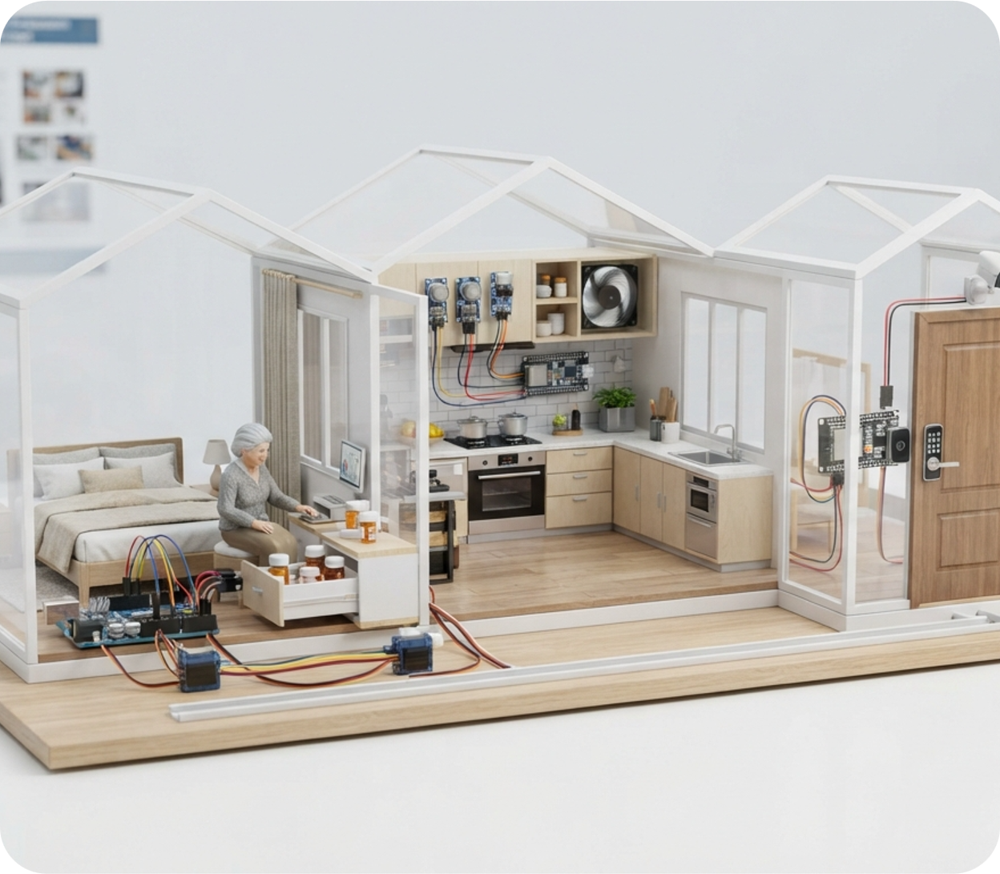

# Smart Independent Living Assistant — Low-Cost Integrated IoT System for Elderly Safety & Remote Caregiver Assistance

[-purple.svg)](https://www.uiu.ac.bd)
[](#hardware-architecture--component-catalog)
[](#core-safety--assistive-modules)
[](#system-architecture--block-diagram)
[](https://drive.google.com/drive/folders/1NkLHjPPzur7MXbTdz5TZnWKyEKplNpUy?usp=sharing)
[](LICENSE)
[](https://github.com/isratjahanrani)

An integrated, low-cost smart-home embedded IoT prototype engineered to assist elderly individuals living independently while reducing the constant monitoring burden on remote caregivers. Developed by **Team Micro Minds** in the Department of Computer Science and Engineering at **United International University (UIU)**, the system combines **automated medication compliance**, **kitchen gas leak and fire mitigation**, **RFID smart entrance security with ESP32-CAM intruder snapshot capture**, and **accelerometer-based fall detection paired with a manual SOS emergency broadcast**.

---

<p align="center">
  
</p>

---

## 📺 Video Demonstrations & Prototype Walkthrough

> [!IMPORTANT]
> **Complete Hardware Prototype Demonstrations Available on Google Drive:**  
> 🔗 **[Access Video Demonstrations Here](https://drive.google.com/drive/folders/1NkLHjPPzur7MXbTdz5TZnWKyEKplNpUy?usp=sharing)**
>
> **Recorded Demonstration Scenarios Include:**
> 1. **Smart Pill Drawer Compliance:** DS3231 RTC trigger, automated SG90 servo drawer unlatching, compliance timer window ($W$), and missed-dose notification logic.
> 2. **Kitchen Hazard Autonomous Response:** MQ-2 gas detection and flame sensing, automated servo-driven gas shut-off valve closure, and DC exhaust ventilation fan activation via relay.
> 3. **Smart Entrance & Intruder Capture:** RC522 RFID card authentication, unauthorized access buzzer alarm, and hardware interrupt trigger to ESP32-CAM for intruder photo capture.
> 4. **Fall & Distress Emergency Path:** MPU-6050 free-fall/impact inertial response, tactile SOS button fallback, local siren/OLED display, and remote caregiver alert dispatch over Wi-Fi.

---

## Table of Contents

- [Overview & Motivation](#overview--motivation)
- [Key Features](#key-features)
- [System Architecture & Block Diagram](#system-architecture--block-diagram)
- [Core Safety & Assistive Modules](#core-safety--assistive-modules)
  - [1. Smart Medicine Compliance & Automated Pill Cabinet](#1-smart-medicine-compliance--automated-pill-cabinet)
  - [2. Kitchen Hazard Detection & Autonomous Mitigation](#2-kitchen-hazard-detection--autonomous-mitigation)
  - [3. Smart Entrance Security & Intruder Image Capture](#3-smart-entrance-security--intruder-image-capture)
  - [4. Fall Detection & Manual SOS Emergency System](#4-fall-detection--manual-sos-emergency-system)
- [Hardware Architecture & Component Catalog](#hardware-architecture--component-catalog)
- [System Wiring & Interface Pinout Table](#system-wiring--interface-pinout-table)
- [State Transition & Decision Logic](#state-transition--decision-logic)
- [Engineering Constraints, Safety & Ethics](#engineering-constraints-safety--ethics)
- [Repository Structure](#repository-structure)
- [Research Team & Academic Information](#research-team--academic-information)
- [License & Acknowledgments](#license--acknowledgments)

---

## Overview & Motivation

According to the World Health Organization (WHO), falls are the second leading cause of unintentional injury deaths worldwide, with adults over 60 suffering the greatest proportion of fatal falls. Simultaneously, seniors living independently face compounding daily vulnerabilities:
- **Chronic Medication Non-Compliance:** Forgetting prescription schedules or taking incorrect dosages due to cognitive decline.
- **Kitchen Hazards:** Diminished olfactory sensitivity leading to undetected LPG gas leaks, unattended stovetop fires, and toxic smoke inhalation.
- **Vulnerability to Intruders:** Physical frailty making older adults targets for unauthorized home entry.
- **Delayed Emergency Intervention:** Becoming incapacitated after a fall with no one nearby to call for medical assistance.

Existing market solutions are fragmented, cost-prohibitive, and often limited to passive reminders. The **Smart Independent Living Assistant** addresses this gap by uniting four vital safety functions into a single, low-cost, open-source embedded platform ($< \$50$ total BOM) with **local offline fallback autonomy** that keeps life-critical functions operating even if internet or Wi-Fi connectivity drops.

---

## Key Features

- 🏥 **Physical Medication Latch & Compliance Verification:** Unlike passive reminder apps, the system physically locks medication drawers, unlocking only during scheduled dosage windows ($5-10\text{ min}$) via an RTC-synchronized servo latch and logging whether the drawer was actually opened.
- 🔥 **Autonomous Kitchen Hazard Mitigation:** Senses LPG, smoke, and flame, immediately actuating a servo valve to isolate the gas supply line while activating an exhaust ventilation fan through an optically isolated relay.
- 📸 **Event-Triggered Photographic Surveillance:** Conserves bandwidth and preserves privacy by leaving cameras offline during normal operation; captures high-resolution JPEG snapshots via the **ESP32-CAM (OV2640)** only when repeated unauthorized entry attempts are verified.
- 📉 **Dual-Phase Inertial Fall Detection:** Analyzes 3-axis acceleration vectors ($\|\mathbf{a}\| = \sqrt{a_x^2 + a_y^2 + a_z^2}$) from an **MPU-6050** to identify characteristic free-fall weightlessness followed immediately by high-impact spikes and prolonged post-fall inactivity.
- 🚨 **Redundant Emergency Fallback:** Provides a physical tactile SOS emergency push-button accessible at floor/bedside level to trigger instant alarms regardless of sensor status.
- 📶 **Dual-Controller Architecture:** Employs an **Arduino UNO R3** for deterministic, hard real-time sensor polling and actuator control, and an **ESP32 DevKit** as a dedicated Wi-Fi cloud communications gateway.
- 🛡️ **Fail-Safe Local Autonomy:** Core safety actuators (gas shutoff, alarm sirens, door locks, drawer latches) are executed locally on the microcontroller, guaranteeing uninterrupted protection during internet outages.

---

## System Architecture & Block Diagram

The system operates on an event-driven **Sense $\rightarrow$ Decide $\rightarrow$ Act $\rightarrow$ Notify** pipeline:

```
┌────────────────────────────────────────────────────────────────────────┐
│                        SENSE (Input Modules)                           │
│                                                                        │
│  [DS3231 RTC]        [Reed Switch]      [MQ-2 Gas / Smoke Sensor]      │
│  Precise Clock       Drawer Status      LPG, Smoke, Combustible Gas    │
│                                                                        │
│  [IR Flame Sensor]   [PIR Motion]       [RC522 RFID Module (SPI)]      │
│  Fire Detection      Entrance Presence  Authorized Resident Keycards   │
│                                                                        │
│  [MPU-6050 6-DOF IMU]                   [Tactile SOS Push-Button]      │
│  3-Axis Acceleration & Dynamics         Manual Instant Alarm Trigger   │
└───────────────────────────────────┬────────────────────────────────────┘
                                    │
                                    ▼
┌────────────────────────────────────────────────────────────────────────┐
│               DECIDE (Central Real-Time Controller)                    │
│                                                                        │
│                        Arduino UNO R3 (ATmega328P)                     │
│  • High-frequency sensor polling & multi-sample noise filtering        │
│  • Schedule compliance evaluation & window timer management            │
│  • Kinematic fall pattern detection (Free-fall + Impact + Inactivity)  │
│  • Direct control of local actuators and alarm indicators              │
└───────────────────┬────────────────────────────────┬───────────────────┘
                    │                                │ UART Serial Frames
                    ▼                                ▼
┌──────────────────────────────────────┐  ┌──────────────────────────────┐
│        ACT (Local Actuators)         │  │    NOTIFY (IoT Gateway)      │
│                                      │  │                              │
│  • SG90 Servos (Drawer, Valve, Lock) │  │   ESP32 DevKit (Wi-Fi)       │
│  • 12V DC Exhaust Fan (via Relay)    │  │   • Formats event payloads   │
│  • 0.96" I2C SSD1306 OLED Display    │  │   • Sends alerts to phone    │
│  • Piezo Buzzer & Red Flashing LEDs  │  │                              │
└──────────────────────────────────────┘  └──────────────┬───────────────┘
                                                         │ Hardware Trigger
                                                         ▼
                                          ┌──────────────────────────────┐
                                          │      ESP32-CAM (AI-Thinker)  │
                                          │  • Captures intruder JPEG    │
                                          │  • Streams image to caregiver│
                                          └──────────────┬───────────────┘
                                                         │
                                                         ▼
                                          ┌──────────────────────────────┐
                                          │   Remote Caregiver Alert     │
                                          │ (Push Notification / Cloud)  │
                                          └──────────────────────────────┘
```

---

## Core Safety & Assistive Modules

### 1. Smart Medicine Compliance & Automated Pill Cabinet
- **Sensors:** DS3231 I2C Real-Time Clock, Reed Switch (drawer contact on `D4`).
- **Actuators:** SG90 Servo (latch mechanism on `D7`), 0.96" OLED display, Piezo Buzzer (`A3`).
- **Control Logic:**
  1. The Arduino checks the current timestamp against programmed prescription dose times $(t_i, d_i)$.
  2. When $t = t_i$, the servo rotates to unlock drawer $d_i$, the OLED displays *"TAKE MEDICINE"*, the buzzer emits rhythmic chimes, and a compliance timer $W \in [5, 10]\text{ minutes}$ is initialized.
  3. If the drawer is pulled open (reed switch open) before $W$ expires, compliance is logged, alarms stop, and the drawer re-locks once pushed back.
  4. If $W$ expires with no opening, the drawer automatically re-locks to prevent unauthorized access or accidental double-dosing, and a `MISSED_DOSE` warning is dispatched to the caregiver.

$$\text{Compliance Event} = \begin{cases} \text{Compliant}, & \text{if } t_{\text{open}} \le t_i + W \\ \text{Missed Dose Alert}, & \text{if } t_{\text{open}} > t_i + W \end{cases}$$

---

### 2. Kitchen Hazard Detection & Autonomous Mitigation
- **Sensors:** MQ-2 Gas/Smoke Sensor (analog output `A0`), IR Flame Sensor (digital output `D2`).
- **Actuators:** SG90 High-Torque Servo (gas line valve shutoff on `D8`), 5V Relay triggering 12V DC exhaust fan (`A2`), Emergency Siren (`A3`).
- **Control Logic:**
  1. Continuous analog sampling of MQ-2 readings with rolling-window noise filtering.
  2. If the analog voltage exceeds the calibrated threshold $\theta_g$ for $N$ consecutive samples, or if the IR flame sensor transitions to active-LOW:
     - The gas valve servo is rotated $90^\circ$ to physically cut off the fuel supply.
     - The relay module switches on the high-speed DC exhaust fan to ventilate flammable gas/smoke outdoors.
     - The piezo siren and red LED trigger continuous local alerts.
     - A priority `KITCHEN_HAZARD` serial message is forwarded to the ESP32 for immediate caregiver dispatch.

---

### 3. Smart Entrance Security & Intruder Image Capture
- **Sensors:** RC522 RFID Reader (SPI on `D9-D13`), HC-SR501 PIR Motion Sensor (`D3`), Door Reed Switch (`D5`).
- **Actuators:** SG90 Servo (deadbolt lock on `A1`), ESP32-CAM module (OV2640 camera), Local Alarm.
- **Control Logic:**
  1. PIR sensor detects motion at the entryway, activating the RFID reader.
  2. Resident swipes RFID tag:
     - **Authorized UID:** Door lock servo disengages for 10 seconds, then re-locks once the reed switch confirms closure. Failed attempt counter is reset ($c = 0$).
     - **Unauthorized UID / Tampering:** Lock remains engaged, warning beep sounds, and counter increments ($c \leftarrow c + 1$).
  3. If $c \ge 3$ consecutive failed attempts occur within 60 seconds:
     - System enters **Intruder Lockdown Mode**.
     - Hardware trigger line from ESP32 (`GPIO4`) pulses ESP32-CAM (`GPIO13`).
     - ESP32-CAM captures a high-resolution snapshot of the visitor/intruder and transmits the security incident photo directly to the caregiver.

---

### 4. Fall Detection & Manual SOS Emergency System
- **Sensors:** MPU-6050 6-Axis Inertial Measurement Unit (I2C `0x68`), Tactile Floor/Bedside Push-Button (`D6`).
- **Actuators:** Continuous Strobe LED, High-Decibel Siren, OLED Emergency Banner, Cloud SOS Packet.
- **Kinematic Fall Algorithm:**
  1. Computes total acceleration magnitude $\|\mathbf{a}\|$ at $50\text{ Hz}$:
     $$\|\mathbf{a}\| = \sqrt{a_x^2 + a_y^2 + a_z^2}$$
  2. **Free-Fall Detection:** Checks if $\|\mathbf{a}\| < \theta_{\text{ff}}$ (typically $< 0.5g$) representing weightlessness during an uncontrolled collapse.
  3. **Impact Verification:** Checks if within $\Delta t < 500\text{ ms}$, acceleration surges past the impact threshold $\|\mathbf{a}\| > \theta_{\text{imp}}$ (typically $> 2.5g - 3.0g$).
  4. **Post-Fall Inactivity:** Monitors motion for duration $T_i$ ($5-10\text{ s}$). If the senior remains stationary on the floor, the emergency is confirmed.
  5. **Manual Fallback:** Depressing the physical SOS push-button bypasses sensor algorithms and triggers the emergency state unconditionally.
  6. **Action:** Siren sounds, red LED flashes continuously, OLED displays *"EMERGENCY"*, and an urgent `FALL_EVENT` notification is sent over Wi-Fi.

---

## Hardware Architecture & Component Catalog

| Category | Component Model | Interface | Operating Voltage | System Role |
| :--- | :--- | :---: | :---: | :--- |
| **Central Controller** | Arduino UNO R3 (ATmega328P) | Digital / Analog / I2C / SPI | 5V | Real-time sensor polling, timers, local actuation logic |
| **IoT Gateway** | ESP32 DevKit (ESP-WROOM-32) | UART Serial / Wi-Fi | 3.3V (5V VUSB) | Wi-Fi connectivity, caregiver cloud notification dispatch |
| **Vision Subsystem** | ESP32-CAM (AI-Thinker OV2640) | GPIO Trigger / Wi-Fi | 5V | Event-driven intruder snapshot capture & image streaming |
| **Real-Time Clock** | DS3231 High-Precision RTC | I2C (`A4/A5`, address `0x68`) | 3.3V / 5V | Battery-backed accurate time base for medicine schedules |
| **Motion Tracking** | MPU-6050 6-DOF IMU | I2C (`A4/A5`, address `0x69`) | 3.3V / 5V | Accelerometer and gyroscope data for kinematic fall detection |
| **Gas / Smoke** | MQ-2 Gas/Smoke Sensor Module | Analog (`A0`) | 5V | Detection of LPG, smoke, methane, and combustible gases |
| **Flame Detection** | IR Flame Sensor Module | Digital (`D2`, Active LOW) | 3.3V / 5V | Rapid optical detection of open kitchen fire/flame |
| **Motion Presence** | HC-SR501 PIR Sensor | Digital (`D3`, Active HIGH) | 5V | Entryway motion detection to wake up RFID subsystem |
| **Access Control** | RC522 RFID Reader Module | SPI (`D9-D13`) | 3.3V Logic | Contactless smart-card identification for door access |
| **Door / Drawer** | Magnetic Reed Switches (x2) | Digital (`D4, D5`) | 5V (Pull-up) | Contact sensing for medicine drawer and entrance door closure |
| **Emergency Trigger**| Tactile Heavy-Duty Push-Button | Digital (`D6`) | 5V (Pull-up) | Instant manual panic button for the resident |
| **Actuators** | SG90 Micro Servos (x3) | PWM (`D7, D8, A1`) | 5V (Dedicated Rail)| Actuates medicine drawer latch, gas valve, and door deadbolt |
| **Ventilation** | 12V DC Exhaust Fan + Relay | Relay IN (`A2`) | 5V Coil / 12V Load| Optically isolated exhaust ventilation for kitchen gas leaks |
| **Local Display** | 0.96" SSD1306 OLED (128x64) | I2C (`A4/A5`, address `0x3C`) | 3.3V / 5V | Local alerts, medicine reminders, and status messages |
| **Local Alarms** | Active Piezo Buzzer + Red LEDs | Digital/Analog (`A3`) | 5V | Multi-tone acoustic siren and optical hazard warnings |

---

## System Wiring & Interface Pinout Table

```
Arduino UNO R3 Pin Assignments:
┌───────────────────────┬────────────────────────────────────────────────────────┐
│ Arduino UNO Pin       │ Connected Module / Subsystem                           │
├───────────────────────┼────────────────────────────────────────────────────────┤
│ A0 (Analog In)        │ MQ-2 Gas & Smoke Sensor (Analog Output AO)             │
│ A1 (Analog / GPIO)    │ SG90 Servo: Entrance Door Deadbolt Latch               │
│ A2 (Analog / GPIO)    │ 5V Relay Control (IN) ➔ 12V DC Exhaust Fan             │
│ A3 (Analog / GPIO)    │ Piezo Buzzer & High-Intensity Red LED (Parallel)       │
│ A4 (I2C SDA)          │ Shared I2C Bus: DS3231 RTC, MPU-6050, 0.96" OLED      │
│ A5 (I2C SCL)          │ Shared I2C Bus: DS3231 RTC, MPU-6050, 0.96" OLED      │
├───────────────────────┼────────────────────────────────────────────────────────┤
│ D0 (RX) ➔ GPIO17 (TX) │ UART Serial link from ESP32 DevKit                     │
│ D1 (TX) ➔ GPIO16 (RX) │ UART Serial link to ESP32 DevKit (via voltage divider) │
│ D2 (External INT0)    │ IR Flame Sensor Digital Output (Active LOW)            │
│ D3 (External INT1)    │ HC-SR501 PIR Motion Sensor Output (Active HIGH)        │
│ D4 (Digital In)       │ Magnetic Reed Switch: Medicine Drawer (Pull-up)        │
│ D5 (Digital In)       │ Magnetic Reed Switch: Entrance Door (Pull-up)          │
│ D6 (Digital In)       │ Manual Tactile SOS Emergency Button (Pull-up)          │
│ D7 (PWM Out)          │ SG90 Servo: Smart Medicine Drawer Latch                │
│ D8 (PWM Out)          │ SG90 Servo: Kitchen Gas Valve Safety Shut-off          │
│ D9 (SPI RST)          │ RC522 RFID Reset Pin (3.3V logic)                      │
│ D10 (SPI SS / SDA)    │ RC522 RFID Slave Select (3.3V logic)                   │
│ D11 (SPI MOSI)        │ RC522 RFID Master Out Slave In                         │
│ D12 (SPI MISO)        │ RC522 RFID Master In Slave Out                         │
│ D13 (SPI SCK)         │ RC522 RFID Serial Clock                                │
└───────────────────────┴────────────────────────────────────────────────────────┘
```

> **Power & Ground Architecture:** High-current inductive loads (3x SG90 servos and the DC fan relay) are powered from an **independent external 5V/3A regulated power rail** to prevent voltage sags and microcontroller brownouts. All power supplies share a common ground reference.

---

## State Transition & Decision Logic

```
   ┌────────────────────────────────────────────────────────┐
   │                  System Idle / Normal                  │
   └───────┬──────────────┬──────────────┬──────────────┬───┘
           │              │              │              │
[Dose Time Arrived] [Gas/Flame Trip] [PIR + Card Read] [Inertial Fall/SOS]
           │              │              │              │
           ▼              ▼              ▼              ▼
   ┌──────────────┐┌──────────────┐┌──────────────┐┌──────────────┐
   │ Pill Cabinet ││Kitchen Hazard││ Door Access  ││ Fall Alert   │
   │ State        ││ Mitigation   ││ Verification ││ State        │
   └───────┬──────┘└──────┬───────┘└──────┬───────┘└──────┬───────┘
           │              │               │               │
      Drawer Open?   Close Valve,    Authorized UID?   Free-fall +
      • Yes: Logged  Ventilate Fan,  • Yes: Unlock     Impact + Still?
      • No: Relock,  Alarm Siren,    • No: Fail Count  • Alarm Siren
        Missed Alert Send Cloud      • Count >= 3:     • Red Flashing
                                       Intruder Shot,  • Caregiver SOS
                                       Alert Caregiver
```

---

## Engineering Constraints, Safety & Ethics

1. **Life-Safety Redundancy:** The prototype is an assistive aid engineered to complement, rather than substitute, professional healthcare and certified commercial life-safety alarms.
2. **Privacy Protection by Design:** To protect the dignity and privacy of the elderly resident, cameras are never kept in continuous video streaming mode; optical sensors are only energized to capture an image when a physical security intrusion threshold is breached.
3. **Fail-Safe Mechanism Design:** In the event of complete electrical outage, the kitchen gas shut-off valve is biased towards a closed state, while the door deadbolt supports manual mechanical key override from the interior.
4. **Bandwidth Optimization:** Sensor telemetry is processed and filtered at the edge by the Arduino; only high-level status state transitions and emergency frames are transmitted over Wi-Fi.

---

## Repository Structure

```
Elderly-Suport-System/
├── assets/                                      # High-resolution architectural figures
│   ├── system_hero.png                          # System design concept and overview illustration
│   └── team_banner.png                          # Project title and academic group banner
├── report.pdf                                   # Complete 10-page IEEE formatted technical project report
├── Independent_Living_Assistant_Presentation_01.pptx # 13-slide academic presentation deck
├── .gitignore                                   # Standard git rules for hardware and temp files
├── LICENSE                                      # MIT Open-Source License
└── README.md                                    # Comprehensive system documentation
```

---

## Research Team & Academic Information

This project was developed by **Team Micro Minds** for the **Microprocessor and Microcontroller Laboratory** course in the **Department of Computer Science and Engineering** at **United International University (UIU)**, Dhaka, Bangladesh.

### Authors (Team Micro Minds)
| Name | Student ID | Department | Institution |
| :--- | :---: | :---: | :--- |
| **Maisha Tabassum** | 0112230333 | CSE | United International University (UIU) |
| **Mohiuddin Nafees** | 0112230322 | CSE | United International University (UIU) |
| **Mehnaz Fatima** | 0112230937 | CSE | United International University (UIU) |
| **Israt Jahan Rani** | 011201376 | CSE | United International University (UIU) |
| **Robiul Islam Tamim** | 011212039 | CSE | United International University (UIU) |

---

## License & Acknowledgments

- **License:** Distributed under the [MIT License](LICENSE).
- **Video Demonstration Archive:** Hosted permanently on [Google Drive](https://drive.google.com/drive/folders/1NkLHjPPzur7MXbTdz5TZnWKyEKplNpUy?usp=sharing).
- **Academic Acknowledgment:** The team expresses sincere gratitude to the faculty and laboratory instructors of the CSE Department at **United International University (UIU)** for providing the embedded systems laboratory facilities, testing instruments, and academic mentorship.
